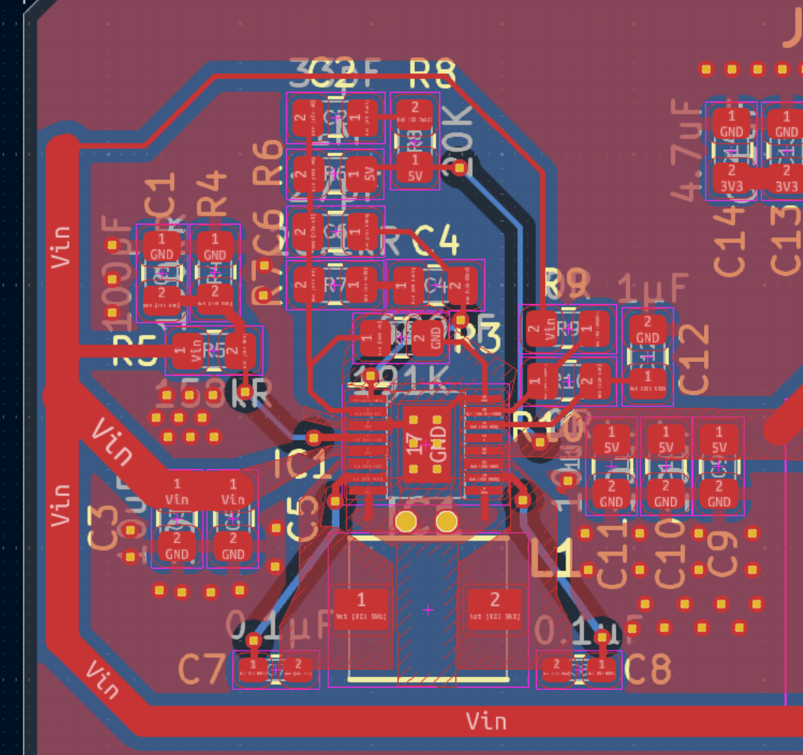
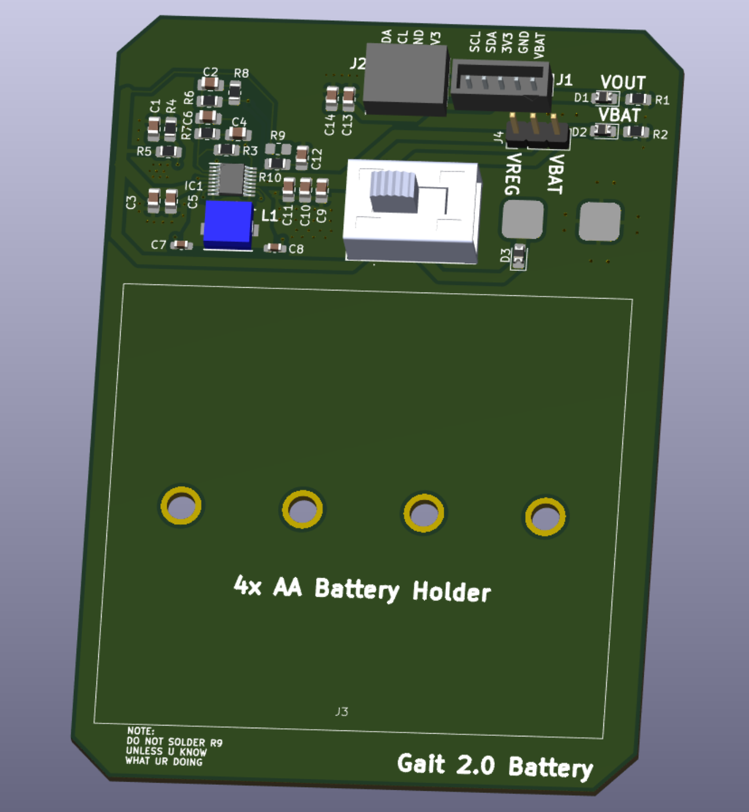

# Hardware design portfolio

[Back to profile](https://github.com/elitetq) · Other portfolios: [Firmware](firmware.md), [Software](software.md), [PCB design](pcb-design.md)

> **Legend:** 🎥 Video demo · 🖨️ Custom PCB (KiCad) · 📖 Build and usage guide · 🚧 Work in progress · 👥 Team project

Circuit and system design, from power supplies and boards to digital design verification. Board layout details are on the [PCB design page](pcb-design.md).

## Gait 2.0 power supply for BMERIT 🖨️ 👥

A regulated 5 V supply for the Gait 2.0 battery board, built around the [LTC3111](https://www.analog.com/en/products/ltc3111.html) synchronous buck-boost converter in the MSE package. The LTC3111 accepts 2.5 V to 15 V in and out and delivers up to 1.5 A. A 4x AA pack sits both above and below 5 V as it discharges, so a buck-boost keeps the rail steady for the whole battery life. I followed the LTC3111 datasheet for component selection and layout.

The rest of the battery board includes a slide switch, status LEDs for the regulated output and the battery, and a connector that carries 3V3, GND, VBAT and the I2C lines to the upper module.

I also worked on the upper module, which has an ESP32-based module, a microSD slot and a buzzer. See the [PCB design page](pcb-design.md) for both boards.

## hid-controller 🎥 🖨️ 📖

A custom USB gamepad on an STM32F103 with my own KiCad schematic, PCB, fabrication files and firmware. It has two analog sticks, a D-pad, face buttons, bumpers and digital triggers, and it enumerates on Linux as a custom HID device called J-Controller. Windows only partly enumerates it so far. [View the repo](https://github.com/elitetq/hid-controller).

## JAARK 🖨️

A Bluetooth remote controlled car and its handheld controller on two STM32F446 boards. I did most of the RC car PCB in KiCad. The car adds a metal detector and ultrasonic ranging. [View the repo](https://github.com/elitetq/JAARK).

## rotating-disk-uvm 🚧 📖

A UVM testbench for a rotating disk position controller, run on Vivado XSim and written by hand to teach myself UVM. The PWM and clamp blocks are verified with constrained-random stimulus, golden-model scoreboards, SVA assertions, functional coverage and a Python regression script. The quadrature decoder and controller are still to do. [View the repo](https://github.com/elitetq/rotating-disk-uvm).
