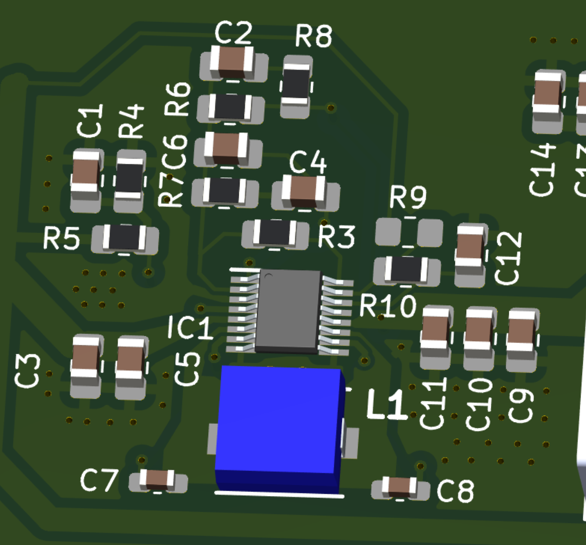
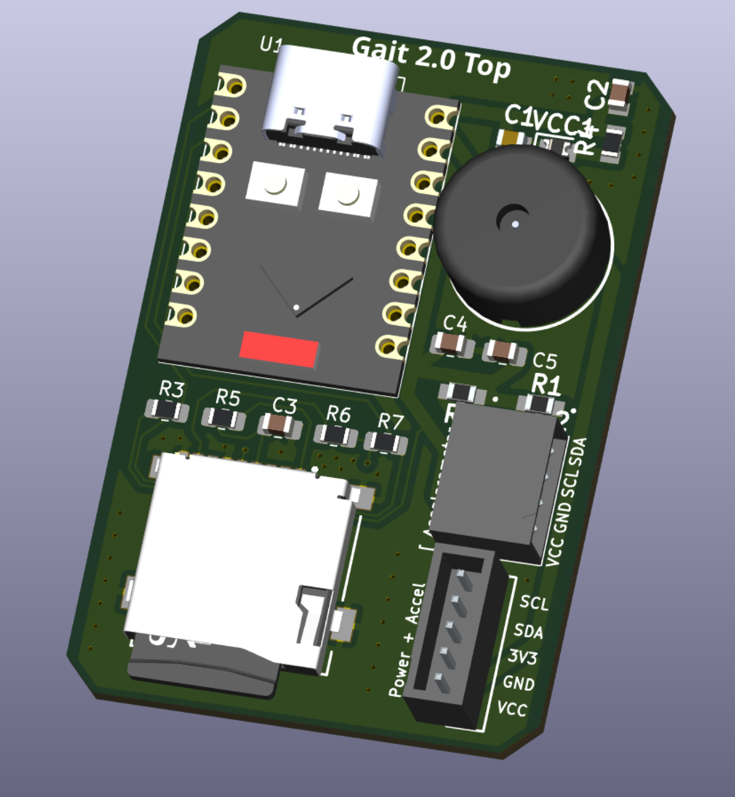

# PCB design portfolio

[Back to profile](https://github.com/elitetq) · Other portfolios: [Hardware design](hardware-design.md), [Firmware](firmware.md), [Software](software.md)

> **Legend:** 🎥 Video demo · 🖨️ Custom PCB (KiCad) · 📖 Build and usage guide · 🚧 Work in progress · 👥 Team project

Boards I have designed in KiCad, from schematic through layout and fabrication files.

## Gait 2.0 for BMERIT 🖨️ 👥

Gait 2.0 is a two-board design. I worked on both the upper and lower modules as part of the BMERIT electrical team.

### Buck-boost power supply

A regulated 5 V supply for the battery board, built around the [LTC3111](https://www.analog.com/en/products/ltc3111.html) synchronous buck-boost converter in the MSE package. The LTC3111 accepts 2.5 V to 15 V in and out and delivers up to 1.5 A. A 4x AA pack sits both above and below 5 V as it discharges, so a buck-boost keeps the rail steady for the whole battery life. I followed the LTC3111 datasheet for the design and the recommended layout.

Layout choices visible in the board:

- Wide Vin traces and copper for the battery input current
- Input capacitors on Vin and three output capacitors on the 5V rail placed right next to the IC
- Small 0.1 µF capacitors placed tight against the inductor, with short traces to the IC
- The exposed pad (pin 17) tied to GND, with ground vias stitched around the decoupling capacitors
- An unpopulated resistor (R9) with a silkscreen warning not to fit it unless you know what you are doing

### Lower module: battery board

The battery board carries the power circuitry and the pack connection.

- A 4x AA battery holder footprint that fills most of the board
- A slide switch for power
- The LTC3111 buck-boost supply described above
- A 5-pin connector to the upper module carrying SCL, SDA, 3V3, GND and VBAT
- A 3-pin header with VREG and VBAT pads
- Status LEDs for the regulated output (VOUT) and the battery (VBAT)

### Upper module: top board

The top board holds the processing and storage side of the stack.

- An ESP32-based module with USB-C
- A microSD card slot
- A buzzer
- A 5-pin power and accelerometer header (SCL, SDA, 3V3, GND, VCC) and a second I2C connector (SDA, SCL, GND, VCC)

## hid-controller 🎥 🖨️ 📖

A custom USB gamepad on an STM32F103 with my own KiCad schematic, PCB, fabrication files and firmware. It has two analog sticks, a D-pad, face buttons, bumpers and digital triggers. The repo includes the schematic, BOM, placement export and Gerbers. [View the repo](https://github.com/elitetq/hid-controller).

## JAARK 🖨️

A Bluetooth remote controlled car and its handheld controller on two STM32F446 boards. I did most of the RC car PCB in KiCad. [View the repo](https://github.com/elitetq/JAARK).

## More BMERIT boards

### CyberStride

Designed the PCBs and cleaned up the PCB wiring. Fixed issues like floating grounds and messy routing, and standardized SMD component sizes.

### Dementia remote

Helped fix the remote's dimensions and component placement to fit the mechanical design.

## Schulich Press Start devkit 🚧

As founder of Schulich Press Start, I am building the PCB devkit for a Game Boy-style handheld from scratch in KiCad, working from reference designs. The repo is private.
